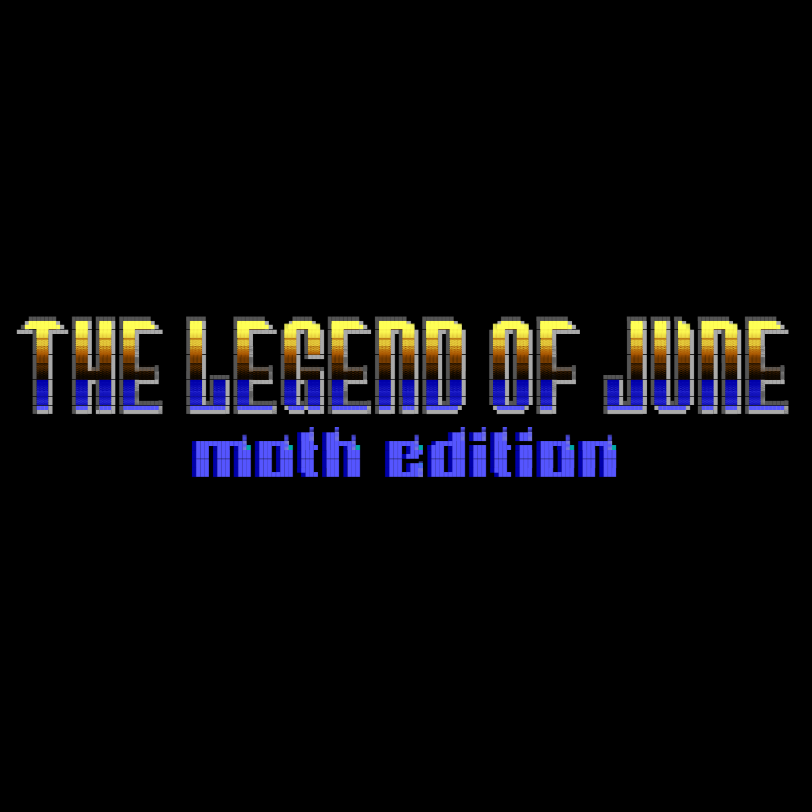

<p align="center">
  
</p>

Juego ASCII de supervivencia para la terminal, inspirado en *The Legend of Zelda*. Esquivá
proyectiles, atacá con la espada y sobreviví oleadas cada vez más difíciles.

Proyecto del curso **Arquitectura de Computadores** (TEC). Esta versión es la **Etapa 2**:
el juego completo en C++ con ncurses, probado en Raspberry Pi 4 B.

## Cómo se juega

- 10 puntos de vida, dibujados como `[##########]`; cada golpe quita uno.
- Al morir, un enemigo puede soltar un corazón que recupera vida.
- Tres tipos de enemigo: soldados, arqueros y magos.
- La partida corre a 30 cuadros por segundo, sin punto flotante (posiciones en punto fijo).

## Controles

| Acción | Teclas |
| :--- | :--- |
| Iniciar | `Enter` |
| Mover | Flechas o `W` `A` `S` `D` |
| Atacar | `Espacio` |
| Pausa | `P` |
| Salir | `Q` o `Esc` |

## Mapas

Quince mapas de 60×20 celdas, en `mapa1.txt` … `mapa15.txt`: Clasico, Cruz, Cuatro cuartos,
Barras, Columnas, Serpiente, Pasillos, Anillos, Zigzag, Gemelos, Aspa, Fortaleza, Puertas,
Espiral y Campos. Para crear uno propio, copiá cualquiera y respetá el tamaño.

## Compilar y ejecutar

Requisitos: g++ con C++17, ncurses y una terminal de al menos 80×24.

```bash
sudo apt install build-essential libncurses-dev
make
./june
```

`make run` compila y ejecuta en un paso.

## Rendimiento

```bash
make bench              # N = 10, 20, 40 y 64, sin pantalla
make bench-pantalla     # igual, pero midiendo también refresh() de ncurses
./june --bench N        # una sola medición
```

Reporta microsegundos por cuadro (lógica, dibujado y `refresh()`), el costo aislado de
`mover_entidades`, `colisiones` y `copiar_sprite`, y la fracción del cuadro que ocupan las
rutinas (dato para la Ley de Amdahl). `--sin-pantalla` no dibuja, así que no mide `refresh()`.

## Equipo

| Integrante |
| :--- |
| Andrés Rodríguez Orozco |
| Sebastián Marín Mora |
| Julián Solórzano Hernández |
| Abril González Morales |

## Licencia

Dominio público — [The Unlicense](LICENSE).
